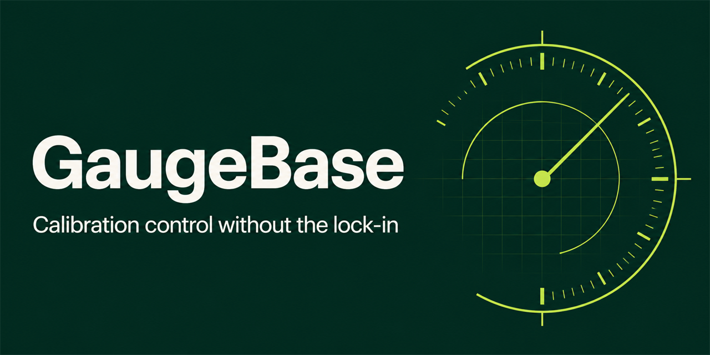

<p align="center">
  
</p>

# GaugeBase

**Open-source, local-first calibration record management with portable data and tamper-evident history.**

Live application: `LIVE_URL_PENDING`

GaugeBase gives quality teams a fast instrument register, due-work dashboard, calibration workflow, certificates, labels, reminders, attachments, migration tools, backups, and complete change history—without a vendor account, seat limit, or proprietary data format.

## What ships in 0.1

- Instrument and reference-standard register with asset ID, serial, manufacturer, model, range, location, custodian, procedure, and lifecycle state
- Due-soon and overdue triage with calendar export and desktop alerts
- Scheduled or unscheduled calibration records with pass, fail, and conditional-pass outcomes
- As-found and as-left test points with stored limits and consistency checks
- Required limitation, review date, and manager approval for conditional pass
- Automatic out-of-service state after a failed result
- PDF calibration records with standards references, readings, prominent outcome, snapshot SHA-256, and accurate disclaimer
- Device-local certificate, procedure, photo, and data attachments with SHA-256 digests
- Privacy-safe QR and Code 128 labels that encode an opaque token instead of personal or equipment details
- Reminder queue with ready-to-send email drafts and optional direct JSON webhook delivery
- Atomic CSV dry run, row-specific validation, safe CSV export, and a migration template
- Append-only application history with before/after data and a verifiable SHA-256 chain
- Lossless JSON backup or password-protected AES-256-GCM `.gaugebase` archive
- Responsive PWA shell that works offline after the first successful load

## Why local-first

The hosted edition stores the complete workspace in IndexedDB inside the current browser profile. There is no GaugeBase account, central record database, analytics service, or phone-home telemetry. Exported records use documented JSON and CSV formats.

That design is excellent for evaluation, small teams, isolated workstations, and organizations that want a zero-infrastructure starting point. It also has an honest boundary: this release is a **single-browser workspace**, not a multi-user validated system. Anyone with access to the browser profile may access its data, and clearing site storage can erase it. Back up regularly.

## Quick start

Requirements: Node.js 22.13 or newer.

```bash
git clone https://github.com/ajayasai/gaugebase.git
cd gaugebase
npm ci
npm run dev
```

Then open `http://localhost:3000`.

Quality gates:

```bash
npm run typecheck
npm run lint
npm test
npm run build
```

## Reminder delivery

Without configuration, **Remind** opens a pre-addressed email draft. To send directly, add an HTTPS webhook in Settings. GaugeBase sends a JSON object containing `to`, `subject`, `text`, and a minimal gauge summary. This works with a private endpoint or automation tools such as n8n, Make, or Zapier. Do not put long-lived secrets in a URL.

## Data and security

- No telemetry is included.
- Attachments are limited to 5 MB each in the UI and remain in the local workspace.
- Encrypted backups use PBKDF2-SHA256 (250,000 iterations) and AES-256-GCM through Web Crypto.
- Audit hashes make history changes detectable, but they cannot prevent a device administrator from replacing local storage.
- Formula-like CSV values are neutralized on export to reduce spreadsheet injection risk.

Read [SECURITY.md](SECURITY.md), [PRIVACY.md](PRIVACY.md), and [the architecture notes](docs/ARCHITECTURE.md) before using GaugeBase with sensitive or controlled records.

## Compliance scope

GaugeBase supports calibration recordkeeping and helps teams prepare evidence for qualified review. It does **not** itself establish ISO/IEC 17025, ISO 9001, FDA 21 CFR Part 11, or other compliance; validate a system; confer accreditation; calculate measurement uncertainty; establish measurement traceability; or replace qualified technical review.

Generated certificates are records produced from organization-supplied data, not independent accreditation or calibration evidence.

## Roadmap

The next major line of work is an optional self-hosted team edition with authenticated roles, technician/reviewer separation, server-side append-only audit sequencing, immutable attachment storage, SMTP scheduling, multi-site support, REST API/webhooks, and SQLite/PostgreSQL deployment. Measurement-system analysis, uncertainty engines, electronic signatures, and AI certificate extraction remain intentionally deferred until they can receive appropriate domain validation.

## Contributing

Issues and pull requests are welcome. Start with [CONTRIBUTING.md](CONTRIBUTING.md) and the [code of conduct](CODE_OF_CONDUCT.md). Security reports belong in GitHub’s private vulnerability-reporting flow, not a public issue.

## License

Apache-2.0. See [LICENSE](LICENSE).
